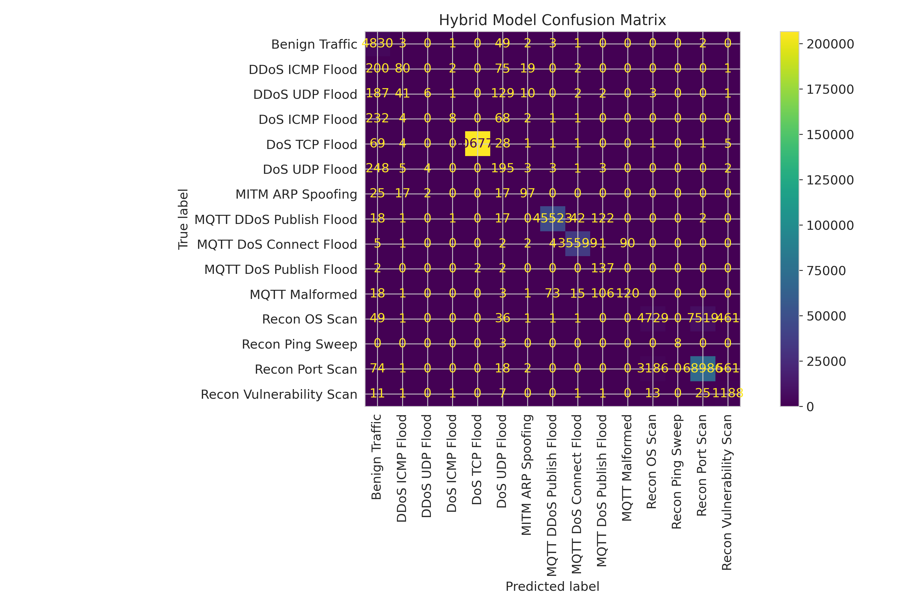
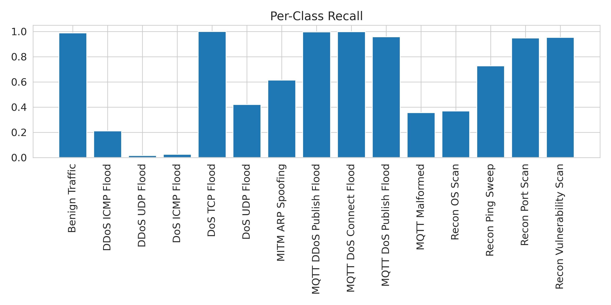
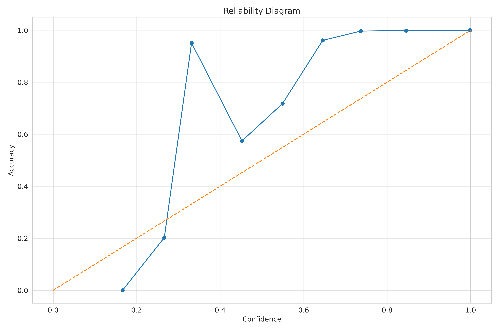
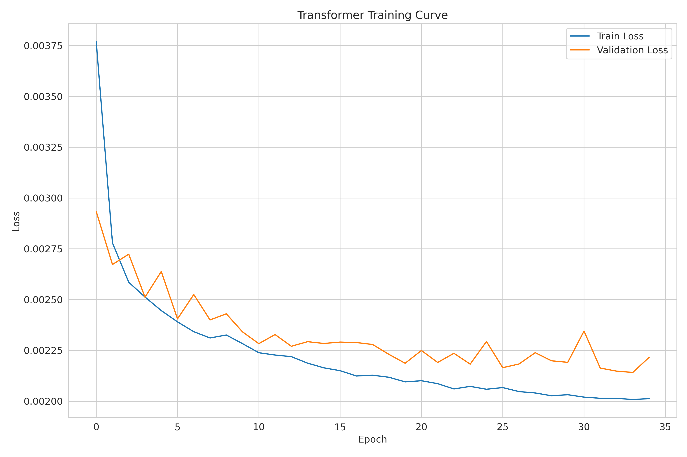
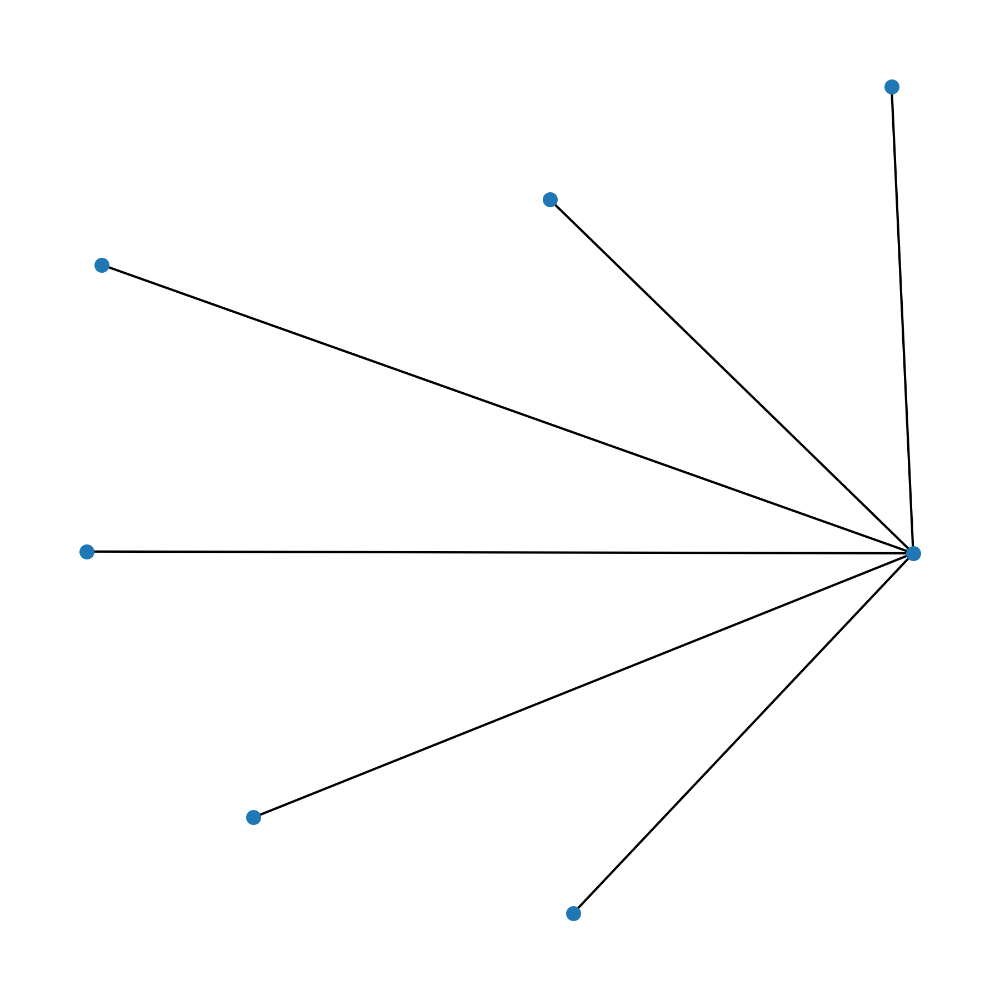
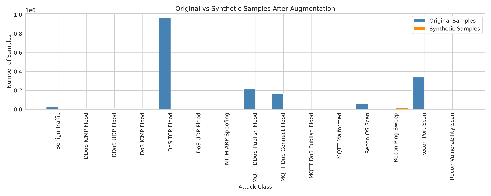

# G-TIDS++ — Graph–Temporal Intrusion Detection for the Internet of Medical Things


**G-TIDS++** is a hybrid, explainable network intrusion detection system (NIDS) for **Internet of Medical Things (IoMT)** networks. It combines a **protocol-aware Temporal Graph Neural Network (TGNN)** that models device-to-device interaction over time, a **Transformer encoder** over flow-level features, a **Random-Forest confidence gate** for fusion, and a **constrained LLM explanation layer** that turns each detection into a clinician- and SOC-readable alert.

This repository contains the research notebooks, the ablation and baseline studies, the reviewer-response experiments, and the artifacts (metrics, figures, and sample explanations) from the final production run.

---

## Table of Contents

- [Highlights](#highlights)
- [Architecture](#architecture)
- [Results](#results)
- [Repository Layout](#repository-layout)
- [Datasets](#datasets)
- [Getting Started](#getting-started)
- [Pipeline Stages](#pipeline-stages)
- [Explainability: LLM Clinical Alerts](#explainability-llm-clinical-alerts)
- [Experimental Integrity](#experimental-integrity)
- [Limitations & Future Work](#limitations--future-work)
- [Citation](#citation)

---

## Highlights

- **15-class multiclass detection** over benign traffic and 14 attack types spanning DoS/DDoS (TCP, UDP, ICMP), MQTT abuse, ARP-spoofing MITM, and reconnaissance.
- **Two complementary views of traffic.** The TGNN learns *who talks to whom, and when* from 1-minute device-graph snapshots. The Transformer learns *what each flow looks like*.
- **Protocol-aware synthetic augmentation** for rare classes. It samples from truncated-normal distributions with protocol constraints (for example, UDP carries no TCP flags and ICMP packets stay small), and synthetic samples are down-weighted during training.
- **Calibrated outputs.** The run reports Expected Calibration Error and a reliability diagram alongside accuracy and F1.
- **Safe, structured LLM explanations.** A GPT-4o (or local-LLM fallback) layer rewrites a **template-grounded** alert. The output is sanitised and validated, and every alert is flagged for human review. The LLM never changes the prediction.
- **Cross-dataset generalisation check** on WUSTL-EHMS-2020, with MMD-based distribution-shift analysis.

---

## Architecture

```text
            Raw IoMT flows (CIC-BCCC IoMT)
                         │
          ┌──────────────┴──────────────┐
          │  Preprocessing & feature     │  log transforms, flag stats,
          │  engineering (28 features)   │  correlation / constant pruning
          └──────────────┬──────────────┘
                         │  stratified split (train / val / test)
                         ▼
          Protocol-aware augmentation (train split only)
                         │
        ┌────────────────┴─────────────────┐
        ▼                                  ▼
 Graph reconstruction               Flow-level features
 (1-min snapshots, global node      (real + down-weighted
  space, device graph)               synthetic samples)
        │                                  │
        ▼                                  ▼
 Protocol-Aware TGNN encoder        GIDSFormer (Transformer encoder)
 • node MLP                         • linear projection → d_model=256
 • per-protocol edge encoders       • 3 pre-norm encoder layers, 4 heads
 • 2-layer GRU over snapshots       • MLP classification head
        │                                  │
        └──────────────┬───────────────────┘
                       ▼
          Fusion gate + Random-Forest confidence gate
          + rare-attack decision thresholds
                       │
                       ▼
          15-class prediction + calibrated confidence
                       │
                       ▼
          Safe LLM explanation layer (post hoc, read-only)
          → structured clinical / technical alert
```

### Core modules (defined in the notebooks)

| Module | Role |
|---|---|
| `FixedProtocolAwareTGNNEncoder` | Node MLP + protocol-specific edge encoders + GRU temporal model over device-graph snapshots |
| `FixedGraphAttentionPooling` | Attention pooling of node embeddings into a snapshot embedding |
| `FixedGIDSFormer` | Transformer encoder classifier over flow features (`d_model=256`, `nhead=4`, `num_layers=3`) |
| `FixedFocalLoss` / `ClassBalancedFocalLoss` | Imbalance-aware objectives for rare attack classes |
| `fuse_predictions` | Combines the Transformer, TGNN, and RF-gate outputs |
| `generate_clinical_alert` | Builds the structured alert and optionally refines it with an LLM |

---

## Results

Final production run (`gtids_production/execution_summary (1).json`), on a held-out test set of **382,271 flows**:

| System | Accuracy | Macro-F1 | Weighted-F1 |
|---|---:|---:|---:|
| Transformer only | 0.9576 | 0.5349 | — |
| **G-TIDS++ (final, with RF gate)** | **0.9634** | **0.6093** | **0.9600** |

- Expected Calibration Error (ECE): **0.143**
- Macro-F1 gain of the full system over the Transformer alone: **+0.074 (+13.9 %)**
- End-to-end runtime: about 1 h 43 min on a Kaggle GPU instance

| Data statistic | Value |
|---|---:|
| Original samples | 2,548,473 |
| Training samples (real) | 1,783,931 |
| Training samples (synthetic) | 56,382 (3.2 %) |
| Validation / test samples | 382,271 / 382,271 |
| Features used | 28 |

Baselines (Random Forest, XGBoost, CNN, LSTM, Bi-LSTM, Bi-GRU) and the TGNN-only ablation are in `Notebooks/all-the-baseline-performances.ipynb`. Statistical tests (McNemar, bootstrap CIs) and further calibration analysis are in `Notebooks/reviewer-squery(reviewer1&7).ipynb`.

### Figures

| | |
|---|---|
|  |  |
|  |  |
|  |  |

---

## Repository Layout

```text
G-TIDSpp/
├── Notebooks/
│   ├── journalmodels (4).ipynb                 # Final G-TIDS++ pipeline (produces gtids_production/)
│   ├── journalmodels.ipynb                     # Earlier full-pipeline revision
│   ├── journalmodels-3.ipynb                   # Revision with 28k-sample minority augmentation
│   ├── all-the-baseline-performances.ipynb     # RF / XGBoost / CNN / LSTM / Bi-LSTM / Bi-GRU + TGNN ablation
│   ├── reviewers-query.ipynb                   # Corrected baseline comparison for peer review
│   └── reviewer-squery(reviewer1&7).ipynb      # Revision suite: significance tests, calibration, latency
├── gtids_production/
│   ├── execution_summary (1).json              # Metrics, data statistics, integrity flags
│   ├── llm_explanations (1).json               # Sample LLM-generated clinical alerts
│   └── *.png                                   # Evaluation and EDA figures
└── README.md
```

---

## Datasets

| Dataset | Use | Notes |
|---|---|---|
| **CIC-BCCC IoMT** (`CIC_BCCC_IoMT_cleaned.csv`) | Training, validation, test | 2.5 M flows, 15 classes. Mounted on Kaggle at `/kaggle/input/iomtdataset`. |
| **WUSTL-EHMS-2020** | Cross-dataset evaluation | Features aligned with `align_wustl_features`, labels mapped with `map_wustl_labels`. Distribution shift is quantified with RBF-kernel MMD. |

The datasets are **not redistributed** in this repository. Download them from their original publishers and attach them as Kaggle inputs (or update the paths in the configuration cell).

---

## Getting Started

The notebooks target the **Kaggle GPU runtime** (P100/T4) and read from `/kaggle/input/...` and write to `/kaggle/working/gtids_production*`.

### Option A — Kaggle (recommended)

1. Create a new Kaggle notebook and import `Notebooks/journalmodels (4).ipynb`.
2. Attach the CIC-BCCC IoMT dataset, plus WUSTL-EHMS-2020 for cross-dataset evaluation.
3. Enable a GPU accelerator.
4. *(Optional)* Add `OPENAI_API_KEY` as a Kaggle secret to enable GPT-4o explanations. Without it, the layer falls back to template or local output.
5. **Run All.** Artifacts are written to `/kaggle/working/gtids_production/`.

### Option B — Local

```bash
python -m venv .venv && source .venv/bin/activate
pip install "torch>=2.6" torch-geometric numpy pandas scipy scikit-learn xgboost \
            networkx statsmodels transformers openai matplotlib seaborn plotly tqdm jupyter
export OPENAI_API_KEY=...        # optional
jupyter lab
```

Then change the `/kaggle/input/...` and `/kaggle/working/...` paths in the configuration cell to local directories.

> **Hardware:** The full pipeline takes about 1.5–2.5 h on a single 16 GB GPU. The TGNN uses gradient accumulation to stay within memory limits.

---

## Pipeline Stages

1. **Load and validate** the raw dataset (schema checks, label column normalisation, `attack_family` derivation).
2. **Feature engineering.** Flow statistics, time-based and protocol-specific features, TCP-flag statistics, and statistical moments.
3. **Feature selection.** Drop zero-dominated, constant, and highly correlated columns. Filtering is applied **after** the split to avoid leakage.
4. **Stratified split** into train, validation, and test sets.
5. **Protocol-aware augmentation** of the train split only. Rarity tiers (very rare, rare, moderate) get tiered multipliers and soft or hard caps.
6. **Graph construction.** 1-minute snapshots over a global device-node space, with labels set by a frequency × rarity window-labelling rule.
7. **Train the TGNN** on real data only, and the **Transformer** on real data plus down-weighted synthetic data. Early stopping uses validation macro-F1.
8. **Fusion and gating** with a Random-Forest confidence gate and per-class rare-attack thresholds.
9. **Evaluation.** Accuracy, macro/weighted F1, balanced accuracy, per-class recall, confusion matrix, ECE, and the reliability diagram.
10. **Explanation.** Structured alerts for sampled detections, saved to `llm_explanations.json`.

---

## Explainability: LLM Clinical Alerts

Each detection can be turned into a structured, auditable alert:

```json
{
  "clinical_summary": "Suspected DoS TCP Flood activity detected in IoMT traffic",
  "attack_class": "DoS TCP Flood",
  "confidence": 0.71,
  "top_indicators": ["Total Fwd Packet_log", "Dst Port", "Flow Duration"],
  "graph_evidence": ["Repeated communication patterns observed",
                     "Protocol-consistent traffic bursts detected"],
  "recommended_actions": ["Isolate device from network", "Notify security team",
                          "Monitor for further anomalies"],
  "human_review_required": true
}
```

Safety guarantees built into the layer:

- The LLM **only rewrites** a template that is already filled with model outputs. It cannot change the class or the confidence.
- Outputs pass through `_sanitize_output`, `_validate_rewrite`, and `validate_llm_safety` before they are accepted.
- On API failure or validation failure, the alert falls back to the deterministic template.
- `human_review_required` is always `true`. The system supports analysts and does not replace them.

---

## Experimental Integrity

The production run records and asserts the following invariants (see `execution_summary (1).json`):

- The TGNN trains on **real data only**. Synthetic samples are used only by the Transformer, with down-weighted loss.
- Augmentation and feature filtering happen **after** the train/validation/test split, so nothing leaks from the test set.
- The validation split is used **only** for early stopping and model selection of G-TIDS++.
- Checkpoints load safely under PyTorch ≥ 2.6.

---

## Limitations & Future Work

- **Macro-F1 is limited by the rarest classes.** Several attack families have very few samples, which pulls macro-F1 well below accuracy. Better rare-class modelling is the main open problem.
- **Calibration** (ECE ≈ 0.14) leaves room for temperature scaling or other post-hoc calibration.
- The project is notebook-first. A future step is to factor the modules into an installable package with a CLI and unit tests.
- LLM explanations depend on an external API unless a local model is configured.

---

## Citation

If you use this work, please cite this repository. A formal BibTeX entry for the associated manuscript will be added on publication.

```bibtex
@misc{gtidspp,
  title        = {G-TIDS++},
  author       = {RehenumaIlman},
  year         = {2026},
  howpublished = {\url{https://github.com/RehenumaIlman/G-TIDSpp}}
}
```

---

<sub>Maintained by [@RehenumaIlman](https://github.com/RehenumaIlman). Issues and pull requests are welcome.</sub>
